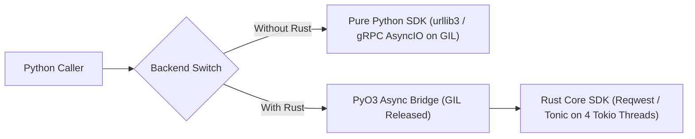

# Evaluating a Shared Rust Core for the Google Cloud Storage Python SDK

## 1. Introduction

To avoid maintaining duplicate handwritten storage logic across languages, our long-term goal is to implement a single core Rust SDK and reuse it across all golden languages (see the [shared native library background](https://docs.google.com/document/d/1pC4PXbBVeXu9xIGn2E3D-Qkd8n87IqUsi8NUYtIXVdE/edit?resourcekey=0-4Uk_EjuRwyGBl76qHPbFuA&tab=t.0#heading=h.yokmyyo3vmmw) for details). This document evaluates that approach specifically for the Python SDK: section 2 covers our proof-of-concept architecture, section 3 compares live read, write, and list performance with and without Rust, and section 4 evaluates the seven technical challenges. Evaluating Go, C++, or Java is out of scope.

## 2. POC and High-Level Architecture

We built a proof-of-concept package in [lib.rs](file:///home/princer_google_com/dev/google-cloud-python/packages/google-cloud-storage-rust/src/lib.rs) and [async_grpc_client.py](file:///home/princer_google_com/dev/google-cloud-python/packages/google-cloud-storage-rust/google/cloud/storage_rust/async_grpc_client.py) that wraps the official Google Cloud Storage Rust SDK using PyO3 and a multi-threaded Tokio runtime, while exposing a backend toggle to run the exact same workloads against the pure Python client.



To avoid blocking the Python event loop or corrupting state across process forks, our bridge follows three steps:
1. The Rust storage and control clients initialize lazily on first I/O rather than at module import time so worker processes forked after import never inherit broken sockets.
2. For each range read up to M1 (256) MiB, Python pre-allocates an uninitialized byte object of length L1 and passes its raw memory pointer to Rust before releasing the interpreter lock.
3. Tokio dispatches the HTTP or gRPC calls across W1 (4) worker threads, copies incoming network chunks directly into the pre-allocated memory without holding the interpreter lock, and re-acquires the lock once at completion to return the finished byte objects.

## 3. Performance Comparison of Read, Write, and List (With and Without Rust)

Because the stable Rust SDK in [read_object.rs](file:///home/princer_google_com/.cargo/registry/src/index.crates.io-1949cf8c6b5b557f/google-cloud-storage-1.20.0/src/storage/read_object.rs) and [write_object.rs](file:///home/princer_google_com/.cargo/registry/src/index.crates.io-1949cf8c6b5b557f/google-cloud-storage-1.20.0/src/storage/write_object.rs) uses HTTP and JSON for object reads and writes (while bidirectional gRPC writes remain behind an unstable compiler flag), we benchmarked both the HTTP/JSON path against the regional bucket princer-flat in [bench_json_workload.py](file:///home/princer_google_com/dev/google-cloud-python/packages/google-cloud-storage-rust/benchmarks/bench_json_workload.py) and the CloudPath gRPC path against the zonal bucket princer-rapid-bucket in [bench_rapid_workload.py](file:///home/princer_google_com/dev/google-cloud-python/packages/google-cloud-storage-rust/benchmarks/bench_rapid_workload.py).

### HTTP/JSON Client Comparison (Regional Bucket princer-flat)

| Operation and Workload | Python JSON Client | Wrapped Rust HTTP/JSON | Speedup (Rust vs Python) | CPU Cost (Python vs Rust) |
| --- | --- | --- | --- | --- |
| Read: 100 x 64 KiB Concurrent Ranges | 158.64 ms (39.4 MiB/s) | 43.20 ms (144.7 MiB/s) | 3.67x faster | 34.47 vs 5.33 CPU-s/GiB (6.47x less) |
| Read: 64 x 1 MiB Concurrent Ranges | 294.24 ms (217.5 MiB/s) | 64.67 ms (989.7 MiB/s) | 4.55x faster | 6.42 vs 1.72 CPU-s/GiB (3.74x less) |
| Read: 16 x 16 MiB Concurrent (Stream Buffer) | 792.21 ms (323.1 MiB/s) | 216.56 ms (1,182.1 MiB/s) | 3.66x faster | 4.46 vs 1.49 CPU-s/GiB (2.99x less) |
| Read: 16 x 16 MiB Concurrent (Zero-Copy Bytes) | 792.21 ms (323.1 MiB/s) | 177.46 ms (1,442.6 MiB/s) | 4.46x faster | 4.46 vs 1.38 CPU-s/GiB (3.22x less) |
| Read: 1 x 100 MiB Single Object (Zero-Copy) | 402.58 ms (248.4 MiB/s) | 362.75 ms (275.7 MiB/s) | 1.11x faster | 2.69 vs 1.74 CPU-s/GiB (1.55x less) |
| Write: 1 x 256 KiB Object Upload | 67.22 ms (3.7 MiB/s) | 59.03 ms (4.2 MiB/s) | 1.14x faster | 5.23 vs 2.71 CPU-s/GiB (1.93x less) |
| Write: 1 x 16 MiB Object Upload | 211.98 ms (75.5 MiB/s) | 181.97 ms (87.9 MiB/s) | 1.16x faster | 0.69 vs 0.62 CPU-s/GiB (1.13x less) |
| Write: 1 x 64 MiB Object Upload | 465.73 ms (137.4 MiB/s) | 521.18 ms (122.8 MiB/s) | 0.89x (resumable + CRC) | 0.60 vs 1.22 CPU-s/GiB (0.49x) |
| List: 1,000 Objects | 60.81 ms (16,445 obj/s) | 58.73 ms (17,028 obj/s) | 1.04x faster | 11.27 vs 3.83 ms/call (2.94x less) |

### CloudPath gRPC Client Comparison (Zonal Bucket princer-rapid-bucket)

| Operation and Workload | Python CloudPath (1 Stream) | Rust CloudPath (1 Stream) | Rust CloudPath (8 Subchannels) | CPU Cost (Python vs Rust 1ch) |
| --- | --- | --- | --- | --- |
| BidiRead: 100 x 64 KiB Ranges | 37.95 ms (164.7 MiB/s) | 23.64 ms (264.4 MiB/s, 1.61x) | 13.02 ms (479.9 MiB/s, 2.91x) | 4.34 vs 2.13 CPU-s/GiB (2.03x less) |
| BidiRead: 64 x 1 MiB Ranges | 200.22 ms (319.6 MiB/s) | 259.59 ms (246.5 MiB/s, 0.77x) | 84.94 ms (753.5 MiB/s, 2.36x) | 4.08 vs 2.43 CPU-s/GiB (1.68x less) |
| BidiRead: 16 x 16 MiB (Stream Buffer) | 1,027.10 ms (249.2 MiB/s) | 760.05 ms (336.8 MiB/s, 1.35x) | 433.05 ms (591.2 MiB/s, 2.37x) | 4.97 vs 2.09 CPU-s/GiB (2.38x less) |
| BidiRead: 16 x 16 MiB (Zero-Copy Bytes) | 1,027.10 ms (249.2 MiB/s) | — | 299.23 ms (855.5 MiB/s, 3.43x) | 4.97 vs 2.35 CPU-s/GiB (2.12x less) |
| BidiWrite: 64 x 256 KiB Appends | 157.98 ms (101.3 MiB/s) | 143.70 ms (111.3 MiB/s, 1.10x) | — | 1.86 vs 1.49 CPU-s/GiB (1.25x less) |
| BidiWrite: 8 x 16 MiB Appends | 495.75 ms (258.2 MiB/s) | 395.07 ms (324.0 MiB/s, 1.25x) | — | 1.32 vs 1.25 CPU-s/GiB (1.05x less) |
| ListObjects: 200 Live Objects | 51.55 ms (3,880 obj/s) | 44.13 ms (4,532 obj/s, 1.17x) | — | 4.90 vs 1.63 ms/call (3.01x less) |

Three practical takeaways explain when Rust helps and when it does not:
- Concurrent multi-range reads see the largest gain (3.43x to 4.55x faster and 3.0x to 6.5x lower CPU) because Tokio runs 16 to 100 range transfers in parallel without contending on the Python interpreter lock.
- Single-stream reads and writes see modest gains (1.11x to 1.25x) because a single CloudPath HTTP/2 or TCP stream is network-bound around 250 to 335 MiB/s. On a 64 MiB JSON upload, Rust is slightly slower (521 ms vs 466 ms) because Rust uses a multi-step resumable upload with full-payload CRC32C verification while Python sends a single-shot multipart post without checksums.
- Preserving Python's mutable byte-stream interface costs 18% to 31% of Rust's read speed (dropping 16 x 16 MiB JSON reads from 1,442.6 MiB/s to 1,182.1 MiB/s) because bytes must be copied a second time into Python stream objects under the interpreter lock.

## 4. Technical Challenges

| Challenge | Python Evaluation (Pure Python SDK vs Wrapped Rust Core) |
| --- | --- |
| Mono Repo | Introducing Rust directly in the monorepo adds Cargo workspace management, native compilation steps, and multi-OS binary wheel build pipelines alongside existing pure-Python packages. |
| Platform-specific issues | Pure Python has zero libc sensitivity; the Rust binary statically links TLS and crypto libraries, requiring CMake/C11 on Alpine musl and matching glibc symbols at runtime. |
| Platform reach | Shrinks from one universal pure-Python wheel to a pre-built wheel matrix per OS, CPU architecture, and Python ABI (including free-threaded builds). |
| Package Size | Pure Python is 336 KiB alone (~11.8 MiB compressed / ~34.5 MiB unpacked with transitive grpcio and cryptography wheels). Our self-contained Rust wheel is 7.7 MiB compressed (20.5 MiB stripped). Adding DirectPath in Rust will increase size slightly, but the overall footprint remains comparable to Python's full gRPC stack. |
| Toolchain, coordination and maintenance costs | Requires a dual Python and Rust toolchain. Even when reusing the core Rust SDK and benefiting from Rust's lower CVE rate, we still need an independent Python-specific effort to maintain the PyO3 binding layer, sync new APIs, and publish multi-OS wheels. |
| Impedance mismatches | Python's JSON client is sync while Rust is async; copying into Python mutable byte streams loses 18% to 31% of read speed; Rust lacks DirectPath today; and Rust uses its own ADC auth and tracing rather than Python credentials and logging. |
| Harder debugging experience | Manageable in practice: while standard Python tracebacks stop at the FFI boundary, AI coding tools simplify cross-language diagnosis, and [PyO3's debugging workflow](https://pyo3.rs/main/debugging) supports Rust panic backtraces, breakpoints in pytest, and step-through IDE debugging via LLDB and GDB. |

### Conclusion

Replacing the pure-Python client with a Rust wrapper delivers large gains (3.4x to 4.5x higher throughput and 3x to 6x lower CPU usage) on concurrent multi-range reads, but offers only modest gains (4% to 25%) on single-stream operations while introducing multi-platform wheel builds and ongoing Python binding maintenance in the monorepo.

## Appendix: How to Run and Verify Manually

You can build the Rust extension, run the dual-backend unit test suite in [test_storage_rust.py](file:///home/princer_google_com/dev/google-cloud-python/packages/google-cloud-storage-rust/tests/test_storage_rust.py), execute both benchmark suites, and verify the wheel and transitive dependency sizes with and without Rust using the repository virtual environment:

```bash
cd /home/princer_google_com/dev/google-cloud-python/packages/google-cloud-storage-rust

# 1. Build and install the PyO3 Rust extension in release mode
VIRTUAL_ENV=/home/princer_google_com/dev/google-cloud-python/.venv \
  /home/princer_google_com/dev/google-cloud-python/.venv/bin/maturin develop --release

# 2. Run parity unit tests across both Python and Rust backends
/home/princer_google_com/dev/google-cloud-python/.venv/bin/pytest tests/test_storage_rust.py -v

# 3. Run live HTTP/JSON client benchmarks against the regional bucket (princer-flat)
GCS_JSON_BUCKET=princer-flat \
  /home/princer_google_com/dev/google-cloud-python/.venv/bin/python benchmarks/bench_json_workload.py

# 4. Run live CloudPath gRPC benchmarks against the zonal Rapid bucket (princer-rapid-bucket)
GCS_RAPID_BUCKET=princer-rapid-bucket \
  /home/princer_google_com/dev/google-cloud-python/.venv/bin/python benchmarks/bench_rapid_workload.py

# 5. Run local in-memory protocol benchmarks (no network required)
/home/princer_google_com/dev/google-cloud-python/.venv/bin/python benchmarks/bench_rapid_workload.py

# 6. Build and compare wheel & transitive dependency sizes (With Rust vs Without Rust)
mkdir -p /tmp/wheels_compare
/home/princer_google_com/dev/google-cloud-python/.venv/bin/maturin build --release --strip \
  -i /home/princer_google_com/dev/google-cloud-python/.venv/bin/python -o /tmp/wheels_compare
uv build --wheel ../google-cloud-storage -o /tmp/wheels_compare
ls -lh /tmp/wheels_compare/*.whl target/release/lib_rust_core.so
du -sh /home/princer_google_com/dev/google-cloud-python/.venv/lib/python3.12/site-packages/{grpc,cryptography,google/_upb,google_crc32c}
# Expected:
#   google_cloud_storage-3.15.1-py3-none-any.whl          (~336 KiB pure-Python wheel alone)
#   + Python transitive native deps in site-packages:     grpc (18 MiB unpacked / 6.8 MiB whl), cryptography (16 MiB / 4.5 MiB whl), _upb (420 KiB), crc32c (96 KiB)
#   google_cloud_storage_rust-0.1.0-cp312-...-x86_64.whl  (~7.7 MiB stripped wheel, self-contained with Reqwest + Tonic + Prost + Rustls)
#   target/release/lib_rust_core.so                       (~28.5 MiB unstripped / ~20.5 MiB stripped shared library)
```


