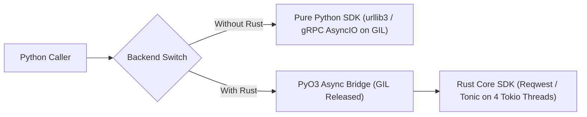
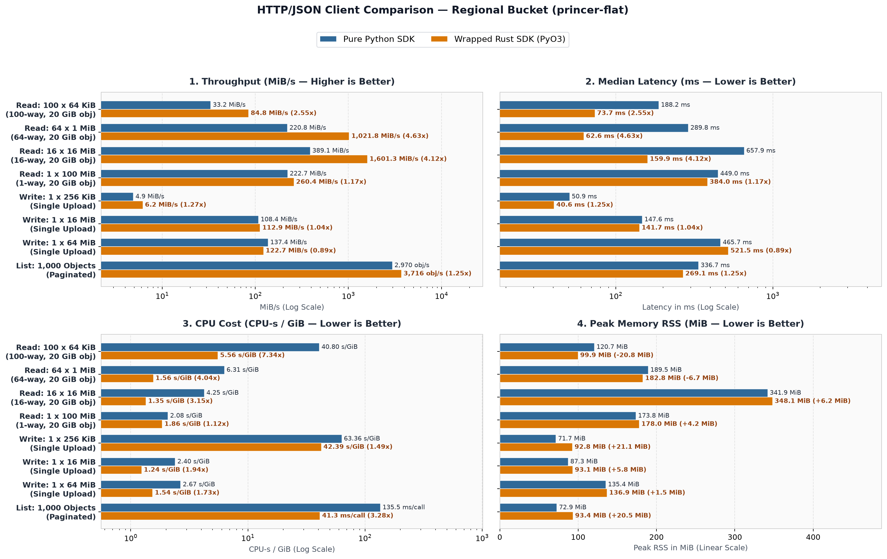
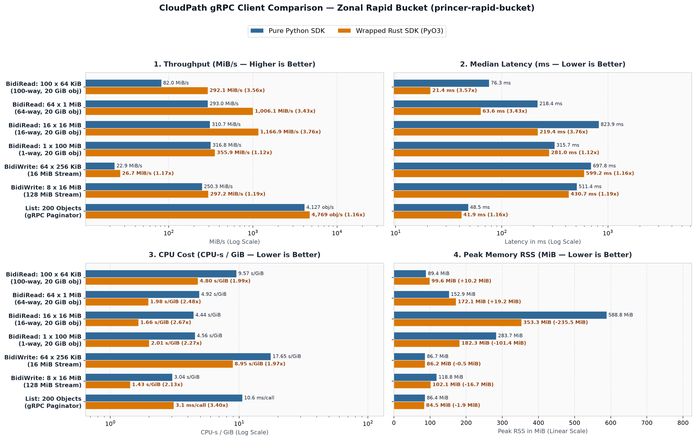

# Evaluating a Shared Rust Core for the Google Cloud Storage Python SDK

## 1. Introduction

To avoid maintaining duplicate handwritten storage logic across languages, our long-term goal is to implement a single core Rust SDK and reuse it across all golden languages (see the [shared native library background](https://docs.google.com/document/d/1pC4PXbBVeXu9xIGn2E3D-Qkd8n87IqUsi8NUYtIXVdE/edit?resourcekey=0-4Uk_EjuRwyGBl76qHPbFuA&tab=t.0#heading=h.yokmyyo3vmmw) for details). This document evaluates that approach specifically for the Python SDK: section 2 covers our proof-of-concept architecture, section 3 compares live read, write, and list performance with and without Rust, section 4 evaluates the seven technical challenges, and section 5 covers multi-platform publishing and alternatives if the Python monorepo does not allow Rust. Evaluating Go, C++, or Java is out of scope.

## 2. POC and High-Level Architecture

We built a proof-of-concept package in [packages/google-cloud-storage-rust/src/lib.rs](src/lib.rs) and [packages/google-cloud-storage-rust/google/cloud/storage_rust/async_grpc_client.py](google/cloud/storage_rust/async_grpc_client.py) that wraps the official Google Cloud Storage Rust SDK using PyO3 and a multi-threaded Tokio runtime, while exposing a backend toggle to run the exact same workloads against the pure Python client.



To avoid blocking the Python `asyncio` event loop or contending on the GIL, the PyO3 bridge does three things:
1. **Converts Rust futures into Python coroutines**: Each storage call uses `pyo3_async_runtimes::tokio::future_into_py` to immediately release the GIL and return a non-blocking Python `Future` to the `asyncio` loop.
2. **Executes all network I/O and checksums on Tokio threads**: A background 4-thread Tokio pool runs the HTTP/JSON and gRPC transfers concurrently off the Python main thread.
3. **Streams directly into Python memory**: Rust writes incoming bytes straight into pre-allocated Python `bytes` buffers (and reads upload payloads directly from Python `bytes` buffers) before waking the Python event loop once on completion.

## 3. Performance Comparison of Read, Write, and List (With and Without Rust)

All benchmarks ran on a Compute Engine VM (192 vCPUs Intel Xeon Platinum 8581C @ 2.30 GHz, 708 GiB RAM, CPython 3.12.14, Rust 1.97.1 with 4 Tokio worker threads), using 1 warmup pass followed by 5 timed iterations:

| Test Suite | HTTP/JSON Path (Regional Bucket `princer-flat`) | CloudPath gRPC Path (Zonal Bucket `princer-rapid-bucket`) |
| --- | --- | --- |
| Read: 100 x 64 KiB | 100-way concurrent range reads on a 20 GiB object (Python `storage.Client` with 100 threads vs Rust `Storage::read_object` via `asyncio.gather`). | 100-way concurrent `BidiReadObject` range reads on a 20 GiB object (Python `AsyncGrpcClient` vs Rust `Storage::open_object` via `asyncio.gather`). |
| Read: 64 x 1 MiB | 64-way concurrent range reads on a 20 GiB object (Python `storage.Client` with 64 threads vs Rust `Storage::read_object`). | 64-way concurrent `BidiReadObject` range reads on a 20 GiB object (Python `AsyncGrpcClient` vs Rust `Storage::open_object`). |
| Read: 16 x 16 MiB | 16-way concurrent range reads on a 20 GiB object (Python `storage.Client` with 16 threads vs Rust `Storage::read_object`). | 16-way concurrent `BidiReadObject` range reads on a 20 GiB object (Python `AsyncGrpcClient` vs Rust `Storage::open_object`). |
| Read: 1 x 100 MiB | 1-way 100 MiB download on a 20 GiB object (Python `blob.download_as_bytes` vs Rust `Storage::read_object`). | 1-way 100 MiB `BidiReadObject` download on a 20 GiB object (Python `AsyncGrpcClient` vs Rust `Storage::open_object`). |
| Write | Single-object uploads of 256 KiB, 16 MiB, and 64 MiB (Python `blob.upload_from_string` vs Rust `Storage::write_object`). | Streaming `BidiWriteObject` appends of 64 x 256 KiB (16 MiB) and 8 x 16 MiB (128 MiB) + flush + finalize (Python `AsyncAppendableObjectWriter` vs Rust `Storage::open_appendable_object`). |
| List | Paginated listing of 1,000 objects (Python `client.list_blobs` vs Rust `StorageControl::list_objects`). | Paginated listing of 200 objects (Python `StorageControlAsyncClient.list_objects` vs Rust `StorageControl::list_objects`). |


### HTTP/JSON Client Comparison (Regional Bucket princer-flat)



### CloudPath gRPC Client Comparison (Zonal Bucket princer-rapid-bucket)



Two practical takeaways explain when Rust helps and when it does not:
- Concurrent multi-range reads see the largest gain (**2.55x to 4.63x higher throughput** — reaching **1,006 to 1,601 MiB/s** vs Python's **221 to 389 MiB/s** — and **2.0x to 7.34x lower CPU** at equal 16-way to 100-way concurrency) because Tokio multiplexes all in-flight range transfers across 4 worker threads without contending on the Python interpreter lock or spawning 64 to 100 OS threads.
- Single-stream reads and writes see modest throughput and latency gains (1.04x to 1.27x) with 1.1x to 2.3x lower CPU usage because a single CloudPath HTTP/2 or TCP stream is network-bound around 220 to 356 MiB/s. On a 64 MiB JSON upload, Rust is slightly slower in throughput (122.7 MiB/s vs 137.4 MiB/s) because Rust uses a multi-step resumable upload with full-payload CRC32C verification while Python sends a single-shot multipart post without checksums.

## 4. Technical Challenges

| Challenge | Python Evaluation (Pure Python SDK vs Wrapped Rust Core) |
| --- | --- |
| Mono Repo | Introducing Rust directly in the monorepo adds Cargo workspace management, native compilation steps, and multi-OS binary wheel build pipelines alongside existing pure-Python packages. |
| Platform-specific issues | Feasible: at runtime, Python's gRPC stack already uses C++ (grpcio) and Rust (cryptography) native extensions, and our Rust binary links fewer system libraries than grpcio (no C++ libstdc++.so.6 dependency). The main change is shifting native build ownership (CMake/C11 for aws-lc-sys on Alpine musl and glibc symbol floors) from upstream grpcio/cryptography maintainers to our team. |
| Platform reach | Feasible: end users installing gRPC dependencies already rely on platform-specific wheels from grpcio and cryptography; our package similarly shifts from a single pure-Python wheel to building and publishing a pre-built wheel matrix per OS, CPU architecture, and Python ABI (or abi3) via maturin/cibuildwheel. |
| Package Size | Pure Python is 336 KiB alone (~11.8 MiB compressed / ~34.5 MiB unpacked with transitive grpcio and cryptography wheels). Our self-contained Rust wheel is 7.7 MiB compressed (20.5 MiB stripped). Adding DirectPath in Rust will increase size slightly, but the overall footprint remains comparable to Python's full gRPC stack. |
| Toolchain, coordination and maintenance costs | Requires a dual Python and Rust toolchain. Even when reusing the core Rust SDK and benefiting from Rust's lower CVE rate, we still need an independent Python-specific effort to maintain the PyO3 binding layer, sync new APIs, and publish multi-OS wheels. |
| Impedance mismatches | Manageable: as the Python SDK moves toward an async-first model, Rust's async Tokio futures map naturally to Python coroutines, and in-progress Rust DirectPath support will be inherited automatically. Productionizing the wrapper only requires handling `os.fork()` runtime re-initialization (`os.register_at_fork`), mapping Rust status codes to `google.api_core.exceptions`, and storing Rust client handles per Python client instance. |
| Harder debugging experience | Manageable in practice: while standard Python tracebacks stop at the FFI boundary, AI coding tools simplify cross-language diagnosis, and [PyO3's debugging workflow](https://pyo3.rs/main/debugging) supports Rust panic backtraces, breakpoints in pytest, and step-through IDE debugging via LLDB and GDB. |

## 5. Multi-Platform Publishing and Alternatives to Rust in the Monorepo

### Publishing Pre-Built Wheels Across All Platforms
To ensure `pip install` never requires a Rust compiler or CMake on end-user machines, we can enable PyO3's Stable ABI (`features = ["abi3-py39"]`) and build wheels in CI using `maturin-action` (or `cibuildwheel`). Because `abi3` produces a single forward-compatible wheel per OS and CPU architecture across Python 3.9 through 3.14+, the release pipeline only needs to publish **6 binary wheels** plus a source distribution (`sdist`) fallback:
- **Linux (`x86_64` and `aarch64`)**: Compiled inside `manylinux_2_28` (glibc 2.28+) and `musllinux_1_2` (Alpine) containers.
- **macOS (`x86_64` and `arm64` Apple Silicon)** and **Windows (`x86_64` and `ARM64`)**: Compiled on native CI runners.

### Alternatives When the Python Monorepo Does Not Allow Rust
If `google-cloud-python` must remain strictly pure Python with no Cargo or multi-platform wheel build pipelines in the monorepo, we have two clean alternatives:

1. **Separate Companion PyPI Package (Recommended — the `google-crc32c` / `pydantic-core` pattern)**:
   - Host the PyO3 + Rust extension outside `google-cloud-python`—either inside the central `google-cloud-rust` repository (e.g., `bindings/python/`) or in a dedicated `google-cloud-storage-core` repository—and publish its `abi3` platform wheels to PyPI as `google-cloud-storage-core`.
   - The `google-cloud-storage` package in `google-cloud-python` stays **100% pure Python** (`py3-none-any.whl`) and simply declares `google-cloud-storage-core` as an optional extra (`pip install google-cloud-storage[rust]`) or standard dependency, mirroring how `google-resumable-media` consumes `google-crc32c`.
2. **Shared C-ABI Dynamic Library (`cdylib`) + Python `cffi`**:
   - Have `google-cloud-rust` publish a language-agnostic C-ABI library (`libgoogle_cloud_storage_ffi.so` / `.dylib` / `.dll`) shared across multiple golden languages, and consume it from Python via a lightweight `cffi` wrapper package.

### Conclusion

Wrapping the shared Rust core SDK for Python is **feasible**: it delivers large gains (2.55x to 4.63x higher throughput and 2.0x to 7.34x lower CPU usage) on concurrent multi-range reads and modest gains (4% to 27%) on single-stream operations, and can be shipped either directly from the monorepo or as a standalone `abi3` companion wheel without adding Rust tooling to `google-cloud-python`.

## Appendix: How to Run and Verify Manually

From the repository root, you can build the Rust extension, run the dual-backend unit test suite in [packages/google-cloud-storage-rust/tests/test_storage_rust.py](tests/test_storage_rust.py), execute both benchmark suites, and verify the wheel and transitive dependency sizes with and without Rust:

```bash
cd packages/google-cloud-storage-rust

# 1. Build and install the PyO3 Rust extension in release mode
VIRTUAL_ENV=../../.venv ../../.venv/bin/maturin develop --release

# 2. Run parity unit tests across both Python and Rust backends
../../.venv/bin/pytest tests/test_storage_rust.py -v

# 3. Run live HTTP/JSON client benchmarks against the regional bucket (princer-flat)
GCS_JSON_BUCKET=princer-flat ../../.venv/bin/python benchmarks/bench_json_workload.py

# 4. Run live CloudPath gRPC benchmarks against the zonal Rapid bucket (princer-rapid-bucket)
GCS_RAPID_BUCKET=princer-rapid-bucket ../../.venv/bin/python benchmarks/bench_rapid_workload.py

# 5. Build and compare wheel & transitive dependency sizes (With Rust vs Without Rust)
mkdir -p /tmp/wheels_compare
../../.venv/bin/maturin build --release --strip -i ../../.venv/bin/python -o /tmp/wheels_compare
uv build --wheel ../google-cloud-storage -o /tmp/wheels_compare
ls -lh /tmp/wheels_compare/*.whl target/release/lib_rust_core.so
du -sh ../../.venv/lib/python3.12/site-packages/{grpc,cryptography,google/_upb,google_crc32c}
# Expected:
#   google_cloud_storage-3.15.1-py3-none-any.whl          (~336 KiB pure-Python wheel alone)
#   + Python transitive native deps in site-packages:     grpc (18 MiB unpacked / 6.8 MiB whl), cryptography (16 MiB / 4.5 MiB whl), _upb (420 KiB), crc32c (96 KiB)
#   google_cloud_storage_rust-0.1.0-cp312-...-x86_64.whl  (~7.7 MiB stripped wheel, self-contained with Reqwest + Tonic + Prost + Rustls)
#   target/release/lib_rust_core.so                       (~28.5 MiB unstripped / ~20.5 MiB stripped shared library)
```


